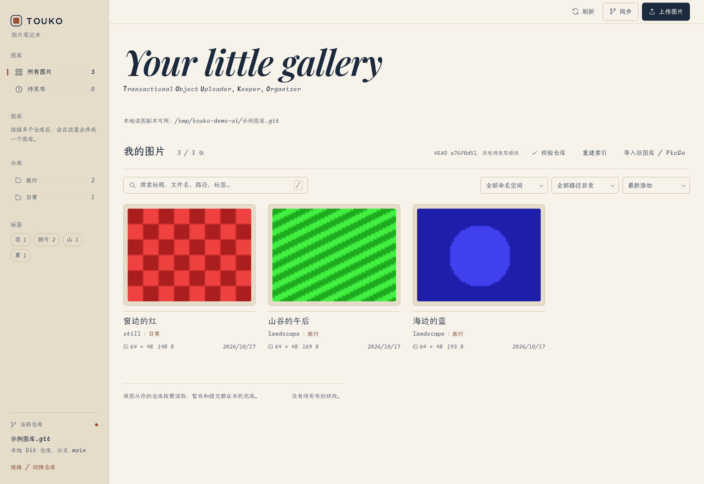
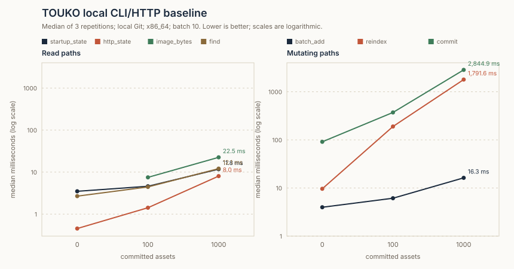
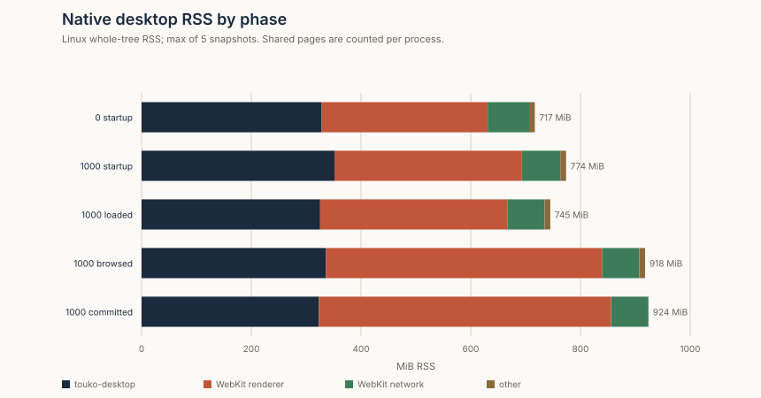

<div align="center">


# TOUKO

把图片存进你自己的 Git 仓库。

内容寻址 · Git 暂存语义 · 本地优先读取 · 多仓库统一图库

[](go.mod)
[](LICENSE)
[](#安装)
[](docs/webview.md)

[简体中文](README.md) · [English](README_en.md)

</div>

---

TOUKO 是一个以 Git 仓库为数据库的图片库。它不把图片交给第三方网盘，而是把图片和元数据写进你自己拥有的仓库。GitHub 仓库是唯一数据源，jsDelivr 只是可选的分发层。

## 名字

TOUKO 取自《终将成为你》（やがて君になる）的七海灯子（Nanami Touko）。

> 好きって、なんだろう。
> 好きって、なに？
>
> —— 七海灯子

她用整个故事追问“喜欢”是什么，也追问自己是谁。图片库面对的是同类问题：一张图属于谁、存在哪里、谁能访问、删掉后还算不算存在。TOUKO 把答案交给 Git：每次改动都有记录，每个文件都以内容命名。

## 为什么不是另一个 PicGo

PicGo 和 PicList 解决的是“上传完就拿到链接”。TOUKO 解决的是“一年后我还能不能找回这张图，并确定它就是我当初上传的那一张”。

| | 传统图床客户端 | TOUKO |
| --- | --- | --- |
| 状态存放 | 远端目录 + 本地配置 | Git 仓库本身，可完整重建 |
| 去重 | 通常无 | 内容寻址，相同字节共用对象 |
| 发布 | 逐张即时上传 | 暂存后一次提交，失败保留现场 |
| 换机 | 重新配置 | `repo use` + `sync` 完整恢复 |
| 删除 | 删文件 | 有定义的删除，历史仍可追溯 |
| 规模 | 单仓库 | 多仓库统一图库，按容量分配 |

## 工作方式

TOUKO 把远端 Git 仓库当作数据库，本地 SQLite 只是可重建的缓存。

- 仓库保存 Asset、对象、标题、标签、分类、MIME、尺寸和内容哈希。
- 文件名由内容的 SHA-256 决定。相同字节天然去重，链接不会指向被覆盖的旧图。
- 上传、编辑和删除先进入暂存区；`commit` 才写成一个 Git 提交。中途失败不会留下半个图库。
- 已存在本地副本时，预览读取本地浅克隆，不联网；需要最新状态时显式执行 `sync`。
- 多个仓库可以合并成一个浏览与上传入口。每个仓库仍保留自己的暂存、提交和恢复语义，上传按剩余容量分配。
- `rm` 从最新树移除图片，但 Git 历史保留；要真正清除需要重写历史，TOUKO 不提供这一功能。

## 格式与空间

TOUKO 接受 PNG、JPEG、GIF 和 WebP。上传 PNG/JPEG 时可以选择转换为 WebP；只有编码后的字节更小时才替换原图，因此不会为了“统一格式”反而增大文件。GIF 和已有 WebP 保持原字节，避免丢失动画或二次有损压缩。

转换在服务端进入暂存区之前完成，对象哈希、大小、扩展名和仓库元数据都描述实际保存的字节。单张图片最大 100 MB，转换上限为 5000 万像素。

博客和笔记中实际引用的 194 张图片迁移到新图库时，质量 85 的结果如下：

| 项目 | 数据 |
| --- | ---: |
| 原始文件 | 78.24 MiB |
| 新图库对象 | 16.87 MiB |
| 节省 | 61.37 MiB（78.4%） |
| 转为 WebP | 171 张 |
| 保持原格式 | 23 张 |

这是针对一批已经存在的图片的一次迁移结果，不是对任意图库的固定承诺。23 张保持原格式，是因为 WebP 编码后反而更大；转换只在字节更少时替换。更小的对象也减少了 CDN 传输和浏览器缓存占用。

## 界面

<div align="center">
  
</div>

界面使用奶油米色与深藏蓝，中文为霞鹜文楷，拉丁文本为 Monaspace Radon。单击卡片复制 Markdown，并在指针旁显示结果。支持拖放、剪贴板粘贴，以及按分类、标签、目录和内容哈希筛选。

图库不会一次性挂载所有卡片。首屏显示 60 张，滚动接近底部时继续加载；离屏卡片跳过布局和绘制。1000 张图库的筛选、滚动与勾选仍然可交互，实测数据见[性能基线](#性能基线)。

## 安装

### 平台与运行依赖

| 平台 | v0.1.0 状态 |
| --- | --- |
| Linux amd64 | 已验证；release pipeline 构建 CLI 与桌面版 |
| macOS | Experimental / unverified；不提供本轮 release artifact |
| Windows | Experimental / unverified；不提供本轮 release artifact |

Linux 桌面已在 Wayland、GTK3 和 WebKitGTK 4.1 上验证。这不代表所有发行版、桌面环境或其他架构都已兼容。CLI 与桌面都需要 Git 支持 SHA-1 仓库和 `show-ref --exists`，建议使用 Git 2.46 或更高版本。桌面版还需要 GTK3、WebKitGTK 4.1；托盘需要 Ayatana AppIndicator 和托盘宿主。GitHub 登录推荐使用 `gh`。

### Release 安装

当前准备的是 v0.1.0 发布基础设施，不表示 tag 或 Release 已创建。正式发布后，从 [GitHub Releases](https://github.com/Eurekaimer/TOUKO/releases) 下载 `touko_0.1.0_linux_amd64.tar.gz` 和同名 `.sha256` 文件，在下载目录执行：

```sh
sha256sum -c touko_0.1.0_linux_amd64.sha256
tar -xzf touko_0.1.0_linux_amd64.tar.gz
sudo install -m755 touko_0.1.0_linux_amd64/bin/touko touko_0.1.0_linux_amd64/bin/touko-desktop /usr/local/bin/
sudo cp -R touko_0.1.0_linux_amd64/share/. /usr/local/share/
touko version
touko-desktop --version
```

预编译包不需要 Go。也可以直接运行解压后的 `bin/touko` 或 `bin/touko-desktop`；桌面条目和图标需要安装到 XDG 路径后才会出现在系统菜单中。缺少系统 WebView 时桌面版会明确失败，CLI 仍可单独使用。

### 从源码构建

使用 `go.mod` 指定的 Go 版本（当前为 1.27.1）和上面的运行依赖：

```sh
git clone https://github.com/Eurekaimer/TOUKO.git
cd TOUKO
go build -o touko ./cmd/touko
go build -o touko-desktop ./cmd/touko-desktop
./touko version --json
```

普通开发构建显示 `dev / unknown`，不会冒充正式版本。版本注入和发布步骤见[版本与发布](docs/usage.md#11-版本与发布)，性能测量方法见 [benchmark](docs/benchmark.md)。

Arch 用户可以从当前 checkout 构建本地包。这不是已发布的 AUR 包，会同时安装两个程序、桌面条目和图标：

```sh
cd packaging && makepkg -si
```

## 快速开始

```sh
# 连接已有仓库，或先 repo init 初始化
./touko --state-dir ~/.local/share/touko repo use Eurekaimer/TOUKO-WEBP-01
./touko --state-dir ~/.local/share/touko sync

# 加图、整理元数据、发布
./touko --state-dir ~/.local/share/touko add photo.png --tag 旅行 --collection 示例
./touko --state-dir ~/.local/share/touko commit -m "images: add a photo"

# 按标题、文件名、标签、分类或内容哈希找回
./touko --state-dir ~/.local/share/touko find 旅行
./touko --state-dir ~/.local/share/touko find 4aff401b
```

常用命令包括 `status`、`ls`、`find`、`show`、`edit`、`rm`、`verify`、`reindex` 和 `import`，全部支持 `--json`。

## 图形界面

```sh
./touko --state-dir ~/.local/share/touko serve --port 7788
```

默认打开浏览器，`--no-open` 只启动服务。也可以运行 `touko-desktop` 打开原生窗口。窗口没有地址栏，但仍使用系统 WebView 渲染。

服务只监听本机回环地址，并校验 Host、Origin 和 CSRF。GitHub 凭据留在服务端进程内，不进入网页。

## 图床与 CDN

GitHub 仓库是源，jsDelivr 是可选分发层：

```text
https://cdn.jsdelivr.net/gh/OWNER/REPO@BRANCH/objects/<ns>/sha256/<aa>/<bb>/<hash>.<ext>
https://raw.githubusercontent.com/OWNER/REPO/BRANCH/objects/<ns>/sha256/<aa>/<bb>/<hash>.<ext>
```

jsDelivr 对 GitHub 包有体积上限，超过后整包返回 403；此时改用 raw 直链即可，内容相同。TOUKO 按容量把图片分配到多个仓库，并为每个 Asset 记录实际所在仓库。

预览按内容哈希返回 ETag 和 immutable 缓存。重复查看同一张图片时，浏览器可以直接复用缓存或得到 304，不需要再次读取 Git 对象。

## 性能基线

以下数据来自本机一次可重复测量：Linux x86_64、20 逻辑 CPU、32 GB 内存、Go 1.27.1、本地 Git 后端，3 次重复取中位数。绝对时间会随机器和缓存状态变化，不能当成固定承诺。



读取路径在 1000 张图时仍是毫秒级；`reindex` 和 `commit` 需要遍历或重写仓库元数据，因此明显更慢。图表的纵轴为对数刻度，避免启动耗时被提交耗时压成一条平线。



RSS 是 Linux 进程树的常驻集，按快照中的最高值选取。共享页会在多个进程中重复计算，所以整树数字不是实际新增的物理内存。空图库启动约 717 MiB，1000 张图浏览后约 918 MiB；WebKit 渲染进程是主要占用者，这部分来自系统 WebView，而不是 Go 业务进程。

复现命令：

```sh
ROOT=$(mktemp -d /tmp/touko-bench.XXXXXXXX)
python3 scripts/benchmark.py --root "$ROOT"
python3 scripts/plot-benchmark.py \
  --benchmark "$ROOT/benchmark.json" \
  --rss "0=$ROOT/profiles/0.jsonl" \
  --rss "1000=$ROOT/profiles/1000.jsonl" \
  --out-dir docs/images
```

## 文档

| 文档 | 内容 |
| --- | --- |
| [Webview](docs/webview.md) | 启动、安全边界、真实 GitHub 验收 |
| [CLI](docs/usage.md) | 从 demo 到多设备、恢复与 JSON 输出 |
| [架构](docs/code-guide.md) | 模块边界、调用链与设计取舍 |
| [函数导航](docs/function-reference.md) | 每个生产函数的输入输出与存在理由 |
| [仓库格式](docs/repository-format.md) | 远端目录结构与版本演进 |
| [本地状态](docs/local-state.md) | SQLite 缓存、耐久暂存与重建 |
| [发布协议](docs/publication.md) | 提交、恢复与删除语义 |
| [Benchmark](docs/benchmark.md) | 可重复的 CLI/HTTP 基线与桌面 RSS 方法 |

## 边界

预览不是缩略图服务，本地和私有仓库不会生成公网链接。`rm` 只从最新树移除文件，Git 历史仍然保留。当前只验证 Linux/Wayland；Windows 和 macOS 的剪贴板路径按 MyGo 契约实现，尚未实机验收。

## 致谢

字体 Monaspace Radon、霞鹜文楷、Quicksand 和 Playfair Display 均为 SIL OFL。原生窗口由 [MyGo](https://github.com/egoist/mygo) 提供。视觉审查参考 Anthropic 的 `frontend-design` 指引。

## License

[MIT](LICENSE)
