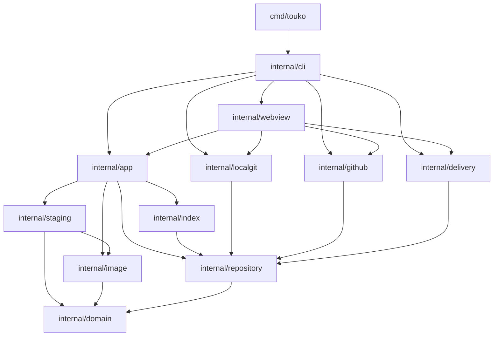

# 从代码重新掌控 TOUKO

这篇教程面向会编程、但没有参与本轮实现的读者。目标不是记住目录，而是能回答三个问题：**一条命令到底改了什么？中途失败留下什么？修改某个功能时，哪些边界不能破坏？**

当前实现管理 PNG/JPEG/GIF/WebP，提供 CLI 和本地浏览器 Webview：以 Git 保存图片和完整元数据，以 SQLite schema2 保存 committed cache，以独立 `workspace.json` 耐久保存暂存修改及发布日志。后端保留本地 Git 与 GitHub Git Data API 写入，GitHub 常规读取使用本地 clone；可选 R2 adapter 独立于 Git publication，没有缩略图服务、插件框架或自动冲突合并。Webview 复用业务核心，并为多个仓库隔离工作区。

本文的函数名以源码为准，不依赖容易变化的行号。逐函数查询见 [函数参考](function-reference.md)，日常操作和 GitHub 接入见 [使用教程](usage.md)。本文中的命令是供你执行的练习，**不是已经运行过的验收记录，也没有虚构运行输出**。GitHub HTTP 测试不等于使用真实 token 完成了线上验收。

## 1. 先分清三种身份与四种状态

### 1.1 UUID、SHA-256、Git SHA 不是同一种 ID

| 身份 | Go 类型及定义位置 | 表示什么 | 不表示什么 |
| --- | --- | --- | --- |
| UUID | `domain.AssetID`、`domain.RepositoryID`，`internal/domain/identity.go` | 一条图片记录，或一个 TOUKO 仓库的稳定身份 | 不由文件名、路径或图片 bytes 决定 |
| 内容 SHA-256 | `domain.ObjectHash [32]byte` | 原始输入 bytes 的内容身份，文本是 64 位小写十六进制 | 不是 Asset ID，也不是 Git blob ID |
| Git 对象 SHA | `domain.RepositoryHead`、`repository.BlobID`、`repository.TreeID` | commit、blob、tree 的 Git 身份；当前后端采用 SHA-1 Git 仓库 | 不等于直接对图片 bytes 求 SHA-256 |

例如，连续两次默认添加同一图片会生成两个UUID，Object.Hash相同；同namespace且同目标目录时共用placement。相同bytes放在不同显式目录仍是不同路径。只改title会改变metadata的Git blob和新commit，不改变图片SHA-256、路径或Asset UUID。

`RepositoryID` 保存在 `.touko/repository.json`。它用于识别“同一个 gallery”，而不是识别 Git 托管平台。`sameRepository` 会阻止把一个不同 RepositoryID 的快照悄悄覆盖到现有缓存中。

`ResolveAsset` 使用完整 UUID 或至少 8 字符的无歧义 UUID 前缀。它不按文件名猜测记录。文件名可以重复，标题也可以重复；把它们当主键会让编辑和删除产生歧义。UUID 文本解析要求规范的小写形式，内容 hash 的文本解析也要求小写。

### 1.2 remote、cache、stage、journal 各自承担什么

这里的 **remote 是逻辑角色**：即使后端是本机 bare Git，它仍是其他设备能够读取的 committed truth，不是指一定经过网络。

| 状态 | 物理位置 | 核心内容 | 丢失或失败意味着什么 |
| --- | --- | --- | --- |
| remote | 选定 Git 仓库的分支及其对象库 | manifest、Asset JSON、图片 blob、提交历史 | 最新分支 HEAD 决定已发布状态；历史不因普通 `rm` 消失 |
| cache | `<state-dir>/index.db` 的 `assets/repository_state` | 上次完整扫描的 Asset、HEAD、tree、manifest | schema2 可保留 durable stage/journal 后 reindex，不必先丢未发布修改 |
| stage | `workspace.json` 的 `changes/base_head`，以及 `stage/objects/` | 尚未发布的 add/update/delete 和新增图片 payload | 不能从 remote 恢复；schema2 删 cache 不丢 stage，但不能丢耐久工作区或所需 payload |
| journal | `workspace.json` 的 `publication` | `BaseHead`、`CandidateHead`、`CandidateTree` | 用于判定“远程可能已成功、本地尚未记账”，不能当临时垃圾随意删除 |

此外，`config.json` 保存 `repository.Location`：`backend,branch,path,owner,name,private`。它只是定位信息，不保存 token。`credential.Resolve` 按 `GITHUB_TOKEN`、`GH_TOKEN`、gh keyring 顺序取得运行时凭据；显式凭据无效不静默回退。

`index.State` 仍是业务读写单位：`Head/Tree/Manifest/Assets` 是 cache，`BaseHead/Changes` 是 stage，`Publication` 是恢复日志。但它们不在同一存储事务里：Store 在互斥保护下组合 SQLite 与耐久工作区。

`ls/find/show` 展示的是 **cache 叠加 stage**，并非每次重新读取 remote：

- `committed`：没有该记录的本地修改；
- `added`：本地新增，还没有发布该 Asset；
- `modified`：本地修改了已有 Asset 的 metadata；
- staged delete：不出现在可见列表中，但仍存在于 `status` 的 changes。

所以“列表里能看见图片记录”不等于“已经提交”。`verify` 不检查暂存 overlay；GitHub CLI/Web 路径验证当前 clone 的固定 HEAD，不 fetch，也不保证它就是最新远端。

## 2. 建议阅读顺序：先确定规则，再读副作用

按下面顺序读，每一步先回答右侧的问题，再进入下一层。不要一开始就追 Cobra 的每一个 flag。

| 顺序 | 文件 | 阅读目标 |
| --- | --- | --- |
| 1 | `internal/domain/identity.go`、`asset.go`、`change.go`、`errors.go` | 谁是身份？什么记录合法？业务冲突如何被 `errors.Is/As` 识别？ |
| 2 | `internal/repository/format.go`、`path.go`、`snapshot.go` | 哪些 bytes 构成 format v1/v2？怎样在兼容读取与显式 path 升级间保持原子性？ |
| 3 | `internal/image/ingest.go`、`internal/staging/files.go` | 大图片如何进入临时文件并被可靠安装？谁拥有并关闭 reader？ |
| 4 | `internal/index/{store,workspace,rebuild}.go`，再读 `internal/app/{state,reindex}.go` | committed cache 与耐久工作区怎样组合？schema1 怎样安全迁移？损坏 cache 怎样绕过 Open 重建？ |
| 5 | `internal/app/stage.go`，再读 `internal/repository/planner.go` | 用户多次操作如何压缩为最终 change？怎样由最终引用集合决定删除？ |
| 6 | `internal/app/{commit,sync,refresh,repo,verify,import}.go` | 哪一步使修改对外可见？更新 clone 与读取怎样持同锁？原路径导入及中断恢复怎样工作？ |
| 7 | `internal/repository/git.go`、`internal/localgit/repository.go`、`internal/github/{client,repository}.go`、`internal/delivery/url.go` | 同一端口怎样落到真实 Git 命令和 HTTP？两者原子性有何差别？ |
| 8 | `cmd/touko/main.go`、`internal/cli/{root,repo,assets,publication,delivery}.go` | 参数、标准输入、输出契约和后端装配如何连接前面的业务？ |
| 9 | `internal/cli/serve.go`、`internal/webview/{server,api,auth,read,workspaces,preview,static,host}.go`、`static/{index.html,style.css,app.js}` | 多工作区 HTTP 边界怎样接到各自 Service？网页状态为什么不能取代耐久 stage？ |

第一遍读每个函数时只标注四件事：**输入、输出、不变量、副作用**。第二遍再跟错误分支。最后通过测试理解为什么需要这些防线，比照着代码逐行翻译更有效。

## 3. 依赖图：每层为何存在，以及不应该做什么

下面的箭头表示代码使用关系；CLI 同时负责实例化具体 adapter，再把 `repository.Git` 传给 application。



### 3.1 领域模型：让非法状态容易被发现

`domain.Asset` 内嵌一个 `ContentObject`，其中有 `hash,mime,ext,size,width,height`。没有再平行存一个可独立修改的 ObjectHash 字段，因此不会出现“Asset 声称一个 hash、Object 又声称另一个”的双写源。

`ContentObject.Validate` 固定支持格式、MIME 对应关系、正数尺寸和 byte 上限；`Asset.Validate` 检查身份、namespace、时间关系与可选真实 `Path`。`ValidateRepositoryPath` 拒绝绝对路径、非规范 POSIX 路径、穿越、反斜杠、控制字符及 `.git/.touko` 段，允许 Unicode 与无后缀原名。它们不访问文件、数据库或网络。领域错误区分“找不到”“有歧义”“冲突”“损坏”，而不是依赖错误文案。

**禁止**在这个包里加入 Cobra、GitHub token、SQL、派生 URL，或按文件名偷偷分配身份。

### 3.2 repository：持久化格式与 Git 协议，不是通用云存储框架

`format.go` 负责稳定 JSON、字段校验及大小限制；`path.go` 区分 canonical 新放置与实际图片路径：

```text
.touko/repository.json
.touko/assets/<asset-uuid>.json
objects/<namespace>/<asset-uuid>.<ext>（旧仓库仍按 sha256/<前2位>/<接着2位>/<完整hash>.<ext> 读取无显式 path 的 Asset）
```

`ObjectPath(asset)` 优先取非空 `Asset.Path`，否则调用 `BuildObjectPath`。默认上传继续 canonical；`--directory` 上传使用 `<directory>/<hash>.<ext>`，导入 PicGo 则保留原路径，不搬动、不重传 bytes。所有读取、删除、引用计数与 URL 都必须使用实际路径，不能各处重新假设 canonical。

`EncodeAsset` 将时间归一为 UTC，空 tags/collections 编码为 `[]`，JSON 末尾有换行。解码拒绝未知字段和尾随 JSON；manifest 最大 64 KiB，单条 metadata 最大 1 MiB。支持 format v1/v2，v1 禁止非空 path。新仓库仍 init v1；只有最终集合出现显式 path 的发布批次才把 v2 manifest 与 metadata 写入同一 commit，普通 v1 上传/编辑不升级，v2 不降级。未知版本失败，不擅自重写。

`ReadSnapshot` 的输入是固定 commit ID，输出 `Snapshot{Manifest,Head,Tree,Assets,Entries}`。它验证安全路径、完整 metadata、UUID 与文件名一致性、同 hash 描述一致性，以及引用对象的路径、mode、类型、大小。任何坏记录都使整个读取失败，而不是跳过坏文件组成一个看似正常的部分 gallery。普通扫描不下载每张图片来重新求 hash。

`git.go` 的 Reader/Writer 描述 Git 本身：读 HEAD/commit/tree/blob、查祖先关系、创建 blob/tree/commit、更新 ref。`TreeChange.Blob == nil` 明确表示删除。

**禁止**把该端口退化为随意 `Put/Delete`：那会抹去 base tree、固定 parent 与唯一发布点这些关键语义。`PlanCommit` 也不能混入随机数、时钟或 IO。

### 3.3 ingest 与 staging：分别处理 bytes 和本地所有权

`image.IngestWithOptions` 接收 `context.Context`、`io.Reader`、临时目录和可选的 WebP 转换参数，返回 `Result{Object,TempPath}`。它负责识别内容，不知道 Asset UUID、title 或远程分支。文件扩展名由 header 解码结果决定，`.jpg` 文件名不能伪装 PNG bytes 的真实格式。转换只作用于 PNG/JPEG，且仅当编码结果更小才替换；GIF/WebP 原样通过，避免丢动画或二次有损压缩。转换需要完整解码，因此有独立的像素上限。

`staging.Install` 接管临时文件，校验后放入 `<state-dir>/stage/objects/<namespace>/<hash>.<ext>`。这个本地路径和 committed 分片路径不是同一个规则。已有 payload 必须校验，不能覆盖不同内容。`Cleanup` 只清理无 stage 引用的 payload，不碰 config、数据库或锁文件。

**禁止**把远程 URL 当 payload，或让清理函数扫描删除整个 state-dir。临时文件的拥有者必须明确：Ingest 失败自行移除；成功后的临时文件由调用者接管；Install 无论成功失败都会消费它。

### 3.4 index：可靠保存本地状态，不代替 remote

`Store.Load` 在 Store 互斥保护下先读 `workspace.json`，再以只读 SQLite 事务取 committed cache，并核对 repository identity。SQL/JSON/metadata 损坏都显式失败，不拼半份状态。

当前 SQLite 单连接、WAL、`foreign_keys=ON`、`user_version=2`，仅有 committed `repository_state/assets`。耐久 workspace 使用自己的 `version:1`，保存 repository identity、base、changes、publication；它与仓库 format v1/v2、SQLite schema 版本不是一回事。`SavePublication` 只原子替换这个 JSON，必须在远程 ref 更新之前成功。

`Save` 先验证两半，**先提交 cache 事务，再写 workspace 临时文件、Sync/Close、Rename、同步目录**。这不是跨资源事务：cache 已前进但 workspace 替换失败时，旧 stage/journal 仍是恢复依据，不能当成第二批未发布操作；rename 后目录 sync 报错也不能假定回滚。

schema1 打开时先验证并耐久复制旧 changes/base/publication，之后才事务删除旧表/列、升级 schema2。中断后两份一致可继续，不一致/坏 stage 则保留源并失败。未迁移的 schema1 若物理不可读，旧库可能是唯一 stage 副本，不能承诺无损恢复。`app.Reindex` 绕过普通 `app.Open` 读 durable state，验证完整固定快照（包括 bytes）后重建 cache；物理坏库及 sidecar 留在 `index-corrupt-*`，健康库原地更新。运行中 Web 使用 `Service.Reindex`，不换仍在使用的 DB 文件。

**禁止**删除 workspace 或为重建抹掉未决 journal。reindex 保留 journal，但恢复发布关系还须 API `sync`；浅 clone 既可能没有 candidate/base，也不能证明完整 ancestry。stage 无 journal 且源 HEAD 变了，reindex 同样报冲突。

### 3.5 application：编排状态，不决定 HTTP 细节

`app.Service` 持有 state-dir 和 Store。它规范化修改、获取本地操作锁，协调 planner、Git 端口、journal 和本地记账。`Commit` 接收 `repository.Git`，并不导入具体 GitHub/localgit 后端。

**禁止**让 CLI 为了“简单”直接 PATCH ref，或让 adapter 遇到冲突自行改用 force。那会绕开恢复协议。

### 3.6 adapters 与 CLI：把机制接起来，不重复业务规则

- `localgit` 使用 `exec.CommandContext` 和 Git plumbing；argv 不经 shell 拼接。`hash-object` 写 blob，tree 构造保留 base 中的其他文件、mode、symlink、gitlink，`commit-tree` 创建 candidate，`update-ref` 才发布。
- `github` 处理 header、HTTP status、流式 base64、Git Data API 字段映射和 token 脱敏。recursive tree 返回 `truncated:true` 就失败，不能更新一个不完整缓存。
- `delivery.BuildURL` 接收 Location、**安全真实仓库相对路径**和 provider，只为 public GitHub 推导 branch URL；不再要求 canonical 哈希目录或后缀。调用方应传 `ObjectPath(asset)`。local/private 返回 `ErrDeliveryUnavailable`。URL 不进 Asset JSON，推导成功不表示 CDN 已传播或 HTTP 可用。
- `cli` 的 runtime 装配 service/backend，把 flags 变为 options，区分 stdout/stderr，返回退出码。它不应重新实现引用计数或 publication recovery。
- `r2` 封装 bucket-scoped AWS S3 SDK，固定 region `auto`，禁重定向及 SDK 隐式重试。`Config` 只含 enabled/endpoint/bucket/public_base_url；`app.CloudflareConfig` 仅严格解析旧 config 的可选子对象，不改变 Location、workspace key 或 metadata。
- `credential.ResolveR2(ctx, dir)` 优先读取完整的两个 `TOUKO_R2_*` 变量；未设置时读取对应工作区的私有 `cloudflare/credentials.json`，不混用两种来源。GUI 设置可保存该密钥对；`GET /api/cloudflare/config` 只报告是否就绪，设置界面的掩码回填使用仅 POST、严格空 body、沿用 Host/Origin/CSRF 与 `no-store` 的 `/api/cloudflare/credentials`，它优先 `LoadR2` 的工作区 pair，仅在无保存文件时使用完整环境 pair，未配置返回 `source:none`。客户端与凭据惰性装配，`app.Open` 不创建 R2 client。所有 R2 错误只输出受控 code、操作、安全 key 和 HTTP status，不拼 SDK 原始错误。

## 4. 顺着命令追踪状态：逐步调用链

以下用 `B` 表示原 committed HEAD，`C` 表示候选 commit，`R` 表示观察到的远程 HEAD。stage 的 base 不是“执行命令时随便再读一次最新分支”，而是**第一条未发布修改绑定的 HEAD**。

### 4.1 add：先落 bytes，最后一次保存整批 change

```text
CLI addCommand
  → 校验 flags / stdin 组合 / Markdown 的仓库条件
  → app.Service.Add
    → Lock → Store.Load → mutable
    → 对每个 input：Ingest → staging.Install → NewAssetID
    → normalize tags/collections → 构造完整 Asset 与 add change
    → bindBase → Store.Save（先 cache 事务，再耐久 workspace）
  → 输出 AssetView 或 UUID / Markdown
```

1. CLI 将打开的文件或单个 stdin reader 交给 Add；文件名取 basename，stdin 未命名时使用 `stdin.<识别出的扩展名>`。未显式给 title 时使用 OriginalName。
2. `mutable` 拒绝没有 committed snapshot 的状态，也拒绝尚未解决的 publication。此时应先 sync/recovery，不是继续堆积本地修改。
3. 每个输入完整流过临时文件，计算 SHA-256、size，并从临时文件读 header。Install 校验且安装 payload。
4. 每次 add 都生成新的 UUID。即使 payload 已存在，也不复用别的 Asset UUID。
5. 内存中准备完所有 changes 后才 `Save`。第几个输入坏掉都不能留下部分 batch rows。
6. 失败会尝试按调用前的 stage 引用清理新产生的无引用 payload；文件系统清理失败仍可能留下无引用文件，不能把这种清理承诺夸大为跨 SQLite/文件系统的单一事务。

| 时刻 | remote/cache HEAD | stage | journal |
| --- | --- | --- | --- |
| add 前 | 都是 B | 可能已有修改 | 必须为空 |
| 摄取过程中 | 不变 | 旧的持久状态尚未改变 | 空 |
| Save 成功 | 不变 | 新 add 已持久化，base=B | 空 |
| 输入或 Save 失败 | 不变 | 原持久状态保留 | 空 |

输出失败不等于业务事务回滚：例如 stdout 被关闭时，Add 可能已经保存成功。此时查 `status --json`，不要凭“没有看到 ID 输出”判断一定没暂存。

### 4.2 metadata edit / rm：修改记录，不直接改 Git

`Edit → Lock → Load → mutable → ResolveAsset(union) → 合并字段 → bindBase → Save`。

`EditOptions.Title` 是指针，tags/collections 也是可选指针：nil 表示“没有提供该字段”，非 nil 的空值表示“明确清空”。CLI 通过 `Flags().Changed` 区分未传 `--title` 与 `--title ""`；`--tag` 是完整替换列表，不是追加。`normalize` 对 tag/collection trim、去空、排序、去重，但不转小写。

`Remove → Lock → Load → mutable → 先解析全部 selectors → 应用 changes → bindBase → Save → cleanup`。先解析全部 selector 的原因是：第二个 UUID 无效时，不能让第一个删除已经生效。重复 selector 会去重。

编辑/删除解析使用 `union`：committed IDs 加 staged adds，**包含 staged-delete 的 committed ID**。可见列表则使用 `overlay` 隐藏 delete。这两个集合不同，才能区分“重复删除”和“从未存在”。

| 当前记录/暂存状态 | 操作 | 新暂存状态 | 用户能观察到什么 |
| --- | --- | --- | --- |
| 新 add | edit | 仍是 add，metadata 为最终值 | 列表显示 added |
| 新 add | rm | 取消该 add | 记录消失，最后一条 change 消失时 base 清空；共享 payload 不误删 |
| committed，无暂存 | 有实际变化的 edit | update | 列表显示 modified，CreatedAt 保留 |
| update | edit | 合并为一个最终 update | 实际变化才更新 UpdatedAt；与当前暂存值完全相同则 no-op |
| committed 或 update | rm | delete，Asset 为 nil | 列表隐藏，但 status 有 delete |
| staged delete | rm | 仍为 delete | 幂等，不生成第二条记录 |
| staged delete | edit | conflict | 不隐式恢复被删记录 |
| 不存在的 UUID | edit/rm | 不变 | not-found；多 selector rm 不部分成功 |

这一层不搬 namespace、不替换图片 bytes，也不更新 remote。最后一个引用是否应删 binary，必须等 commit planner 看到整个最终集合再判断。

### 4.3 commit：计划、对象准备、记日志、移动 ref、再记账

```text
CLI commitCommand → Service.Commit
  → Lock / Load / 优先恢复旧 publication
  → ReadSnapshot(staging base) → PlanCommit
  （不先读 HEAD：发布时的 fast-forward 检查就是过期 base 的拒绝）
  → VerifyObject(复用对象) / uploadStaged(新对象)
  → CreateBlob(metadata) → CreateTree(base.Tree) → CreateCommit(parent=B)
  → Store.SavePublication(B,C,tree)
  → 由计划构造快照 → UpdateRef(B,C)（非 fast-forward 会被拒绝）
  → finalizeSnapshot → 按已确认的写入记账（恢复路径才重读验证）
  → Store.Save(新快照 + 清 stage/journal) → optional Cloudflare mirror → cleanup
```

**规划阶段。** `PlanCommit(base, ChangeSet)` 先检查 base HEAD，再复制 Asset map 并应用所有 normalized changes，生成 `FinalAssets`。随后比较 before/after 的完整 placement 引用集合，生成 metadata writes、new/reused objects 和 deletions，稳定排序输出。它没有 IO；相同输入不取决于网络、时钟或随机数。

关键例子：两个 Asset 引用同一路径，删一个只删 metadata；删最后一个才删 binary。一次 batch 中“删旧 UUID + add 相同路径/bytes”必须保留 binary。相同 bytes 若路径不同则分别计数；显式 path 即使 namespace 不同也按完整 path 共享引用。planner 只删本批移除最后引用的已有 placement，不顺便垃圾回收未知 orphan，也不删无关 Git 文件。

**准备阶段。** 上传新 payload 时，`uploadStaged` 再测实际 size、流式重算 hash；只相信 add 时计算过一次 hash 不足以发现后来磁盘损坏。复用远程 placement 也要验证 bytes，不能因为路径看起来像 hash 就覆盖或盲信它。metadata 是小 JSON，可直接用 bytes reader。

**发布阶段。** 创建 blob、tree 和 detached commit 还没有使修改出现在分支 HEAD 中。只有 `UpdateRef` 是对外发布点。candidate 以 stage base 为唯一 parent；tree 基于原 tree，只应用计划差异，所以 README 等非 TOUKO 文件仍在。

`validateCandidate` 不是只看“Asset 数量相同”：它重建预期计划，核对 journal 的 tree、parent、metadata bytes、object 映射、应删除路径和其他叶子条目的完全保留。恢复、reset、sync 仍走它；普通提交不再回读 candidate，而是由已接受的写入构造状态并做本地一致性检查。

| 失败窗口 | remote | cache | stage/journal | 正确处理 |
| --- | --- | --- | --- | --- |
| 远程 HEAD 已不是 B | R 不变 | 仍 B | stage 保留；本次 blobs 可能已上传但不可达 | ref 更新被拒绝后只读一次关系：conflict；staged update 的 Asset 已被远程删除时 reason 为 `delete_modify` |
| blob/tree/commit 准备失败 | 仍 B | 仍 B | stage 保留；尚未保存 journal 时 journal 为空 | 修复原因后重试；可能已有不可达 Git 对象，不代表发布了部分 gallery |
| journal 保存失败 | 仍 B | 仍 B | stage 保留；以耐久文件实际状态为准，目录 sync 错误也显式返回 | 不允许继续 UpdateRef |
| UpdateRef 明确没发布 | 一般仍 B | 仍 B | stage 与 candidate journal 保留 | commit 可重试同一 candidate；sync 可确认后取消未发布 journal |
| UpdateRef 响应丢失 | 不能只凭错误判断 | 可能仍 B | 保留恢复依据 | read-back + ancestry；仍读不清则报 candidate 与 outcome unknown，运行 sync |
| remote 已发布，Save 失败 | C 或后代 | 可能旧快照，也可能 cache 已提交 | workspace 替换前失败保留旧 stage/journal；rename 后错误须重读 | sync 完成本地记账，不重复发布 |
| 本地 Save 成功，payload 清理失败 | 已发布 | 新快照 | stage/journal 已清 | 报 published head 和清理错误，不能声称远程提交失败 |

没有 stage 时 Commit 会走 sync，不创建空提交。正常提交成功后，stage、journal 与 base 一起清空；本地结果可以来自 C 的合法后代，而不一定机械地停在 C。

### 4.4 sync / recovery：先查发布关系，再决定能否覆盖本地

普通 GitHub CLI/Web 同步是 `SyncWith → Lock → Load 判断 journal → prepare(创建/更新 clone) → syncLocked → clone.Head → ReadSnapshot(固定 head) → sameRepository → Store.Save`。更新与读 HEAD 在同一个工作区锁内，第一次 sync 就读更新后的快照，而不是后台 fetch、下次才生效；这是显式网络动作。底层 `Sync` 本身只读取传入的 Git adapter，不自动 fetch。

- 先把分支解析成一个 immutable commit，再按它的 tree 和 blob ID 读取，避免扫描期间外部分支变化导致“半个旧 gallery 加半个新 gallery”。
- 没有 stage 时，可扫描并替换 cache。
- 有 stage 且 remote HEAD 没变时，可保留 stage 刷新相同 base。
- 有 stage 且 remote 已变时，不自动 rebase/merge，返回 conflict，旧 cache 和 stage 不变。
- metadata 损坏、缺少引用对象、repository identity 不同、GitHub tree 被截断，均不能更新部分 cache。

只要发现 `Publication != nil`，sync/commit/init 首先走 `recoverPublication`：

| 观察到的远程关系 | 含义 | sync | commit/init |
| --- | --- | --- | --- |
| HEAD 是 C，或 C 是 HEAD 的祖先 | candidate 已发布，后面可能还有合法提交 | 验证candidate、读最新快照，先cache后durable清旧stage/journal | 同左，不再次发布 |
| HEAD 仍为 B | candidate 尚未可见 | 清 journal，但保留 stage 与 base | 验证并重试同一 candidate |
| HEAD 与 B/C 无上述关系 | 已有其他分支推进或 rewrite | conflict，保留 stage/journal | 同左 |
| 读 HEAD/祖先关系失败 | 结果未知 | 保留 stage/journal，报 outcome unknown | 同左，不能猜“未发布” |

为什么要查祖先而不是只比较 `HEAD == C`？如果 C 发布后另一设备又提交 D，HEAD=D 也证明 C 已成功；把它当失败重发，会制造重复发布或错误冲突。

GitHub 的 journal 路径由 `SyncWith` 选择 API backend，再在恢复成功后刷新 clone。不能用浅 clone 的 `IsAncestor` 失败/缺对象推断“没有发布”，也不能拿可能过期的 clone HEAD 代替远端证据。reindex 可以先恢复 cache 以便打开 Service，但不会替用户清 journal。

`reset --staged` 不是远程回滚。没有journal时Service只清本地changes/base并回收payload；GitHub CLI构造APIclient但不发HTTP，有journal则必须用权威API先查关系，已发布先记账、未知拒绝、确认未发布才丢计划，不能拿浅clone证明结果。CLI localgit仍会打开本地仓库，所以仓库缺失时不能承诺reset可用；Web lazyGit则延后到实际需要远端时才装配。

`Initialize` 也使用同一 journal 和发布流程，不是 CLI 偷偷插入 manifest。已有合法格式 init 是幂等读取；已有损坏 `.touko` 或被占用的保留路径不能被“初始化”覆盖。GitHub 完全空仓库要先在 GitHub 初始化 README，Git Data API 不能创建空仓库的首个 ref。

### 4.5 verify：检查当前 reader 固定快照的 bytes，不修改状态

`Service.Verify → Head → ReadSnapshot → VerifySnapshot → VerifyObject`。GitHub CLI/Web 使用当前 clone，不 fetch；clone 缺失时 reader 的建立可能需要网络，但验证不会主动刷新已有 clone。要检查刚更新的远端，先显式 sync，再 verify。

1. 固定本次 reader HEAD，先做与 sync 相同的完整格式/引用验证。
2. 从 Asset 集合生成 unique placement，按路径稳定遍历。
3. 核对对应 Git entry 类型、mode、size，再打开 blob 流式计算 SHA-256、实际 byte 数，读取 header 核对格式及宽高；MIME 一致性由 ContentObject 的格式校验保证。
4. 同一 Git blob 的相同描述可复用校验结果，不重复下载求 hash；同一 blob 配上矛盾描述则损坏。
5. 返回 `head/assets/objects`。这里 objects 是 **placement 数**，不是 UUID 数，也不一定等于唯一 Git blob 数；同 bytes 跨 namespace 有两条 placement。

hash/size 不符是 `ErrHashMismatch`，格式或描述冲突是 repository corruption。verify 不下载文件供用户编辑，不修复远程、不推进 SQLite、不发布暂存修改，也不扫描所有 Git 历史。DecodeConfig 检查的是 header，不是把每张图片全量解码成像素。

## 5. 流式内存边界，与四种不同的原子性工具

### 5.1 “流式”具体节省了什么，没有保证什么

- ingest 用 `io.Copy(io.MultiWriter(file, hash), LimitReader(...))` 一次读取 source；之后从已持久化临时文件读 header，不要求 stdin 支持 seek。
- 最大输入是 `100_000_000` bytes。读取上限多取 1 byte，用来区分“恰好到限”和“已经超限”。空输入、坏 header、取消或读写错误不能产生有效 add rows。
- commit 按对象串行上传，文件 reader 在上传过程中计算 hash/size；不先 `ReadAll` 整张图片。
- GitHub CreateBlob 用 `io.Pipe + base64.NewEncoder` 生成 JSON；Content-Length 根据原始 size 计算，不构造完整 base64 string。取消回调独立关闭 pipe，并对可关闭的 source 做一次关闭，最后等待编码 goroutine 退出，防止请求失败后后台仍卡住。
- OpenBlob 使用 raw 响应，verify 读取 header 后继续把整个剩余流送入 hash，不存完整图片或像素。

这不等于“整个程序常量内存”：Asset map、完整 tree entries、CommitPlan、JSON metadata 会驻内存，规模随记录/路径数量增长。CLI 的多文件 add 也会持有这一批打开的文件句柄。bounded image bytes 与全局 metadata 可扩展性是两个问题。

`context.Context` 能让 HTTP、Git 子进程、SQL、循环 reader 协作取消，但它不能魔法中断任意不响应关闭的自定义阻塞 Reader，也不等于撤销已经发布的 Git ref。失败清理中使用 `context.WithoutCancel(ctx)` 是有意让有限的本地回收不被刚刚取消的请求立即打断，不是建立新的后台业务任务。

### 5.2 不要把所有问题都交给一个“锁”

| 工具 | 解决的问题 | 不解决的问题 |
| --- | --- | --- |
| `context.Context` / timeout | 调用链取消、网络等待与子进程生命周期 | 已发布状态回滚、跨资源事务 |
| state-dir 的 `.lock` / `flock.TryLock` | 同一本地状态目录的业务写操作互斥；避免文件安装与 SQLite 修改相互踩踏 | 另一设备、另一个 state-dir 的并发提交 |
| SQLite transaction | committed assets/head/tree/manifest 的整体 cache Save 或 rollback | workspace 的跨文件原子提交、远端发布或 payload 同步回滚 |
| 临时文件 + Sync/Close + Rename + 目录 Sync | 完整 workspace 耐久替换；payload 安装也使用临时文件与 rename | SQLite/workspace/payload 三者的单事务持久性 |
| Git 不可变对象 + ref 更新 | 先准备完整候选树，再一次公开整个 batch | 对象库中完全没有失败尝试留下的不可达对象 |
| publication journal | 跨远程发布和本地记账的中断恢复 | 阻止不受控外部管理员重写分支 |

锁文件是稳定的锁锚点，不在命令结束时删除，也不做所谓 stale-lock 文件清理。忙时返回 `ErrBusy`，不是等待无穷长的队列。

**localgit 与 GitHub 的最后一道并发保护不同：**

- 本地使用 `git update-ref refs/heads/<branch> <next> <expected>`，这是旧 SHA 比较再交换；root 初始化用全零 expected。
- GitHub PATCH ref 的 `force:false` 只保证 fast-forward，接口没有 expected-old-SHA 参数。adapter 会预读 expected，coordinator 固定唯一 parent，并在发布前后检查 HEAD/祖先关系；这能保护正常 non-force TOUKO 并发，但**不能宣称对任意外部 force/reset race 提供严格 CAS**。验收和实际使用分支应禁止 force push。

## 6. 设计取舍：为什么先选择这些限制

### namespace 是物理路由，不只是筛选标签

默认 canonical 路由下，`blog` 与 `notes` 中相同 bytes 拥有同一 SHA-256，但路径不同；引用计算必须按完整 path，否则会误删某个 namespace 的副本。显式 `Asset.Path` 则直接指定真实位置，namespace 不会搬动它；多个 namespace 的记录也可能引用同一原路径。

Git 底层可以为相同 bytes 复用 blob ID；这是 Git 对象去重，不改变 placement 规则。修改路由须同时检查 `ObjectPath`、完整路径引用、format v1/v2 与发布候选验证，不能只改 `BuildObjectPath`。

### 不可变 blob，使检查与恢复可以引用确定对象

创建 blob/tree/commit 不覆盖原对象；只在 ref 更新时公开新状态。恢复可以用 candidate ID 精确检查“当时打算发布什么”，不必依赖一个后来可能已变化的分支 URL。普通删除只让最新树不再引用路径，**不清历史、不销毁历史 bytes，也不保证 CDN 全球缓存立即失效**。

### cache 可重建，stage 不可重建

remote metadata 是完整 Asset 记录，不只是一个文件名索引；所以新设备可还原 UUID、title、tags、collections、尺寸、时间等信息。stage 从未发布，不能指望 fresh sync 把它还原。实际备份或迁移本地未发布工作时，应保留完整 state-dir，而不只保留 config。

### 不自动 merge，是可解释的安全边界

当前 ChangeSet 绑定一个 base。远程变化后，即使看起来只编辑了不同标题，也不悄悄 rebase。原因是需要明确定义删除/编辑、去重引用和 namespace 的合并语义；当前实现选择直接冲突，避免旧设备把远程删掉的 Asset 复活。

明确丢弃后 `reset --staged; sync` 是可用解法，但它会丢掉本地未发布修改，不应作为“无损解决冲突”的宣传。需要保留内容时，先用 `status/show --json` 记录修改，再在新快照上人工重新应用。

### 固定 parent，把用户批次和发布基线绑在一起

candidate 不是随意接到发布瞬间的新 HEAD，而是以 stage base 为唯一 parent。这样 planner 的输入与 commit 的历史基础一致，正常并发的候选成为 sibling，输家不能借一次 fast-forward 检查覆盖赢家。

### 串行 worker，先降低取消与恢复复杂度

一个对象接一个对象上传，限制同时活跃的 reader、编码器、请求和错误。它牺牲大批量吞吐峰值，但让失败边界容易观察：未更新 ref 时 gallery 仍旧，重试不需要拼接“部分上传成功”的可见 gallery。以后若并行化，应保持唯一发布点、错误后全部 worker 可终止，以及 payload 校验不减弱，而不是只加 goroutine。

## 7. 把测试当作故障说明书阅读

不要只看 `if err != nil`。先找每个测试的 **准备状态 → 故障注入点 → 外部观察 → 恢复动作**。优先观察 HEAD、fresh sync gallery、树中实际路径，以及 `workspace.json` 的 stage/journal，而不是内部调用次数。

| 文件/测试 | 建议理解的问题 |
| --- | --- |
| `domain/identity_test.go`：`TestIdentityAndSelectors`、`TestNamespace` | 身份和 selector 为什么不能被文件名/非法 namespace 替代？ |
| `image/ingest_test.go`：`TestIngestContentIdentityAndFormats`、`TestIngestFailuresRemoveTemporary`、`TestIngestAcceptsExactByteLimit` | source 一次读取后如何识别格式？到限与超限怎样区分？失败是否留下可用结果？ |
| `staging/files_test.go`：`TestInstallRejectsCorruptExistingWithoutOverwrite`、`TestCleanupPreservesReferencedPayloadAndUnrelatedFiles` | 相同路径下坏 bytes 为什么必须拒绝，而非覆盖？清理范围如何受限？ |
| `app/stage_test.go`：`TestStagingNormalizationAndSharedPayload`、`TestBatchFailureAndCommittedTransitions` | 用户连续命令如何变成最终 change，而不是操作日志？一个坏输入是否使批量失败？ |
| `index/store_test.go`、`index/recovery_test.go` | cache SQL 失败和 cache 已提交/workspace 未清怎样区分？schema1 迁移何时才可删除旧源？ |
| `repository/planner_test.go`：`TestPlanDeleteSharedObject`、`TestPlanDeleteLastReference`、`TestPlanDeleteAndAddSameBytes`、`TestPlanNamespaceReferenceIsolation` | 删除要看最终引用，不可按 change 顺序立即删 object |
| `app/sync_test.go`：`TestFreshSyncRestoresCompleteMetadata`、`TestSyncRejectsMissingObjectAndRepositoryIdentity` | fresh machine 能还原的是完整记录；坏 remote 不能换掉好 cache |
| `app/commit_test.go`：`TestDeleteModifyConflictDoesNotResurrect` | A 删除、B 旧 edit 后提交，为什么不能复活 Asset？ |
| 同文件：`TestDeleteFailureBeforePublicationLeavesHeadUnchanged` | blob/tree/commit/ref 四个失败点之后，旧 HEAD 与 stage 是否仍可观察？重试是否保留同一已记录 candidate？ |
| 同文件：`TestRecoverLostUpdateRefResponse`、`TestUnknownPublicationOutcomeRetainsJournal` | 响应丢失与实际未发布为什么不是同一件事？后代 HEAD 如何证明发布成功？ |
| 同文件：`TestRecoverSQLiteFailureAfterRemoteCommit` | 真实 SQLite trigger 阻止 head UPDATE 后，remote 成功而本地回滚；移除故障后 sync 如何恢复而不再提交？ |
| 同文件：`TestConcurrentCommitDoesNotOverwrite`、`TestRecoveryRejectsCandidateMetadataAndDeletionCorruption` | 并发输家不能覆盖赢家；只比较 Asset 数量不足以验证 candidate |
| `repository/verify_test.go`：`TestVerifyRejectsCorruptObject` | canonical hash 路径不保证 bytes 真的匹配 |
| `github/repository_test.go`：`TestAdapterPublishesAndDeletesRealGit` | HTTP 测试服务器后面连接真实 localgit，检查新树和 fresh gallery，不是 mock 输入原样返回 |
| 同文件：`TestAPIFailuresPreserveStagingAndHead`、`TestTruncatedTreeKeepsExistingCache`、`TestUploadCancellationClosesBlockedSourceAndJoinsWriter` | 权限/限流/服务错误如何分类并保留状态？不完整 tree 和取消为什么不能伪装成功？ |
| `cli/root_test.go`、`cli/publication_test.go` | 参数预检、stdin、输出流、真实命令闭环如何连接业务 |
| `repository/format_test.go`：`FuzzDecodeAsset` | 解码成功后的 round-trip 与合法路径不变量，而不只是“没有 panic” |

读一条故障测试后，尝试把它填入第 4 节状态表。若你准备改代码，却不能预测上述测试中 HEAD、stage、journal 的结果，先不要改恢复协议。

## 8. 可操作练习：从安全观察开始，再修改局部行为

### 8.1 独立 scratch 仓库，避免触碰自己的正式 gallery

从项目根目录执行。下面的 `IMG` **必须替换成你本机一张真实 PNG/JPEG/GIF 的绝对路径**，不是仓库自带文件的承诺。`mktemp` 创建的 ROOT 专门用于练习，勿改成正式仓库目录。

```bash
ROOT=$(mktemp -d)
go build -o "$ROOT/touko" ./cmd/touko
BIN="$ROOT/touko"
A="$ROOT/device-a"
B="$ROOT/device-b"
IMG='/请替换为真实绝对路径/图片.png'

"$BIN" --state-dir "$A" repo init --local "$ROOT/gallery.git"
"$BIN" --state-dir "$A" status --json
ID=$("$BIN" --state-dir "$A" add "$IMG" --namespace blog \
  --title '学习 demo' --tag '学习' --collection '练习册' --output id)
"$BIN" --state-dir "$A" show "$ID" --json
"$BIN" --state-dir "$A" status --json
"$BIN" --state-dir "$A" commit -m 'exercise: add an image'
"$BIN" --state-dir "$A" verify --json

"$BIN" --state-dir "$B" repo use --local "$ROOT/gallery.git"
"$BIN" --state-dir "$B" sync
"$BIN" --state-dir "$B" show "$ID" --json
```

观察 add 前后的 HEAD 是否相同、commit 后 stage 是否清空，以及 A/B 的完整 metadata 是否一致。所有命令都显式传 state-dir，不会依赖默认 HOME 中已有的选择。`--output id` 专门供 shell 捕获，不要和 `--json` 混用。

需要完整预制闭环时，参照 [使用教程](usage.md) 中的离线 demo；demo 输出的绝对目录应作为后续命令中的实际 ROOT，不能照抄别人的 `/tmp/...`。

### 8.2 观察 metadata edit、共享对象及取消 add

延续上面的 shell 变量：

```bash
"$BIN" --state-dir "$A" edit "$ID" --title '重新命名' --tag '保留' --tag '新标签'
"$BIN" --state-dir "$A" find '重新命名' --json
"$BIN" --state-dir "$A" show "$ID" --json
"$BIN" --state-dir "$A" edit "$ID" --clear-tags
"$BIN" --state-dir "$A" status --json
"$BIN" --state-dir "$A" reset --staged

SECOND=$("$BIN" --state-dir "$A" add "$IMG" --namespace blog --output id)
"$BIN" --state-dir "$A" rm "$SECOND"
"$BIN" --state-dir "$A" status --json
"$BIN" --state-dir "$A" show "$ID" --json
```

第一组应该关注 metadata 与 `modified` 视图，不要拿 title 变化去推测图片 hash 变化。第二组只暂存又取消一个新 UUID，原已提交记录不应受影响。你也可以在取消前 commit 第二个记录，之后依次 rm 两个 UUID 并提交，用 `verify --json` 和实际 Git tree 观察共享/末引用删除。

### 8.3 复现旧设备 edit 与远程 delete 冲突

仅在上述 scratch 中执行。B 从刚刚同步的同一 Asset 开始编辑，A 则删除并提交：

```bash
"$BIN" --state-dir "$B" edit "$ID" --title '设备 B 的旧编辑'
"$BIN" --state-dir "$A" rm "$ID"
"$BIN" --state-dir "$A" commit -m 'exercise: delete on device A'

# 预期该命令返回 conflict（退出码 3），不是成功提交。
"$BIN" --state-dir "$B" commit -m 'exercise: stale edit'
"$BIN" --state-dir "$B" status --json

# 这是明确丢弃 B 的未发布编辑，而不是自动合并。
"$BIN" --state-dir "$B" reset --staged
"$BIN" --state-dir "$B" sync
"$BIN" --state-dir "$B" ls --json
"$BIN" --state-dir "$B" verify --json
```

若 shell 开了 `set -e`，预期失败命令会终止脚本；请逐条执行或自行捕获退出码。不要为了让示例“全绿”而忽略真实冲突。

### 8.4 不改数据的调试方法

优先使用 `status --json` 看 head/base/changes，用 `show --json` 看 overlay，用 `verify --json` 检查 remote。localgit scratch 还可以读真实 Git，不会修改分支：

```bash
git --git-dir="$ROOT/gallery.git" rev-parse refs/heads/main
git --git-dir="$ROOT/gallery.git" log --oneline refs/heads/main
git --git-dir="$ROOT/gallery.git" ls-tree -r refs/heads/main
git --git-dir="$ROOT/gallery.git" show refs/heads/main:.touko/repository.json
```

需要进一步检查 durable journal 时，在没有写命令运行期间读取 workspace；本机装有 `sqlite3` 时可额外只读检查 **committed cache**。不要 UPDATE/DELETE 或手工编辑 JSON 来“修复”状态：

```bash
"$BIN" --state-dir "$A" status --json
cat "$A/workspace.json"
sqlite3 -readonly "$A/index.db" \
  'PRAGMA user_version; SELECT head, tree FROM repository_state; SELECT id FROM assets;'
```

JSON `publication` 存在不一定表示远程失败，也可能是远程已成功、本地未完成；先 sync/read-back，不删日志。不要删除 `.lock` 绕过操作。schema2 cache 删除/损坏可用 `reindex` 保留 stage 重建，但不要删除 workspace 或未迁移旧库；未决 journal 重建后仍须 API sync。验证 committed 可重建性最安全的方法仍是第三个 state-dir `repo use; sync`，无需破坏现有状态。

### 8.5 第一次改代码：收窄 title 筛选，而不是改格式

现有 `find QUERY` 在 `internal/cli/assets.go` 的 `findCommand` 校验非空 query、转小写，再通过 `s.List` 取得 overlay，调用 `internal/cli/root.go` 的 `matches`。`matches` 当前对 title、OriginalName、tags、collections 做大小写不敏感子串匹配。

一个安全的学习修改是：在你自己的工作分支中，把 find 定义为“只查 title”。做法是收窄 `matches` 的匹配字段，保留 query 归一化和 `s.List` 的可见视图；同步更新命令 Short 和使用文档。**不需要改 Asset、SQLite schema、metadata JSON、planner 或 GitHub。** 如果目的是新增可选 title 筛选而非改变 find 契约，先定义 flag 的组合语义，再在 CLI 查询层过滤；不要顺手把 UUID selector 改为按 title 命中。

验证时准备两个 Asset：一个仅 title 命中，另一个仅 tag/filename 命中，检查前者保留、后者按新契约排除；再把命中的 Asset staged-delete，确认不会从 base snapshot 漏出来。还应覆盖大小写、Unicode 和空 query。比较具体 UUID 集合，而不是只断言结果非空。

若以后 Web/TUI 也要复用相同搜索语义，再把明确的纯筛选规则移入 application；现在不要为了一个 CLI 谓词引入搜索服务框架。

### 8.6 新增图像格式：不是只加一个 decoder import

如果练习支持另一种格式，至少逐个核对这些地方：

1. `internal/domain/asset.go`：`ContentObject.Validate` 的 canonical ext/MIME 白名单。明确真实格式名、固定 ext、MIME 和 byte/dimension 约束。
2. `internal/image/ingest.go`：注册可用的 header decoder，并在 `format → ext/mime` 映射中处理新格式。不要根据用户文件扩展名放行。
3. `internal/repository/verify.go`：注册同样可用的 decoder，核对 `DecodeConfig` 返回格式与 canonical ext 的映射；当前 jpeg→jpg 的特殊关系说明了为什么映射不能漏。
4. `internal/delivery/url.go`：路径校验不再限制图片扩展名；调用方应继续使用实际 `ObjectPath`，不要重新引入 canonical-only 假设。
5. `internal/image/ingest_test.go`、`repository/verify_test.go`、`delivery/url_test.go` 和必要的 CLI round-trip：验证真实新格式 bytes 的 ingest/commit/fresh sync/verify/URL，而不是只构造一个看似合法的 ContentObject。
6. `docs/repository-format.md` 与使用说明：format v1/v2 目前都只接受既定内容格式。扩展接受集合会造成旧程序不能读取新记录；先决定版本兼容/迁移策略，不能悄悄改变保证。

不要为了格式扩展添加对象替换、namespace move 或迁移空命令。一个 decoder 可以解 header，也不自动意味着完整图片解码、缩略图或编辑能力已经存在。

### 8.7 GitHub 调试与当前范围

接入时使用**用户自己的专用 gallery 仓库**，不能把开发代码仓库当试验 gallery。先初始化 README，使用隔离 state-dir 选择 `OWNER/REPO`。桌面/网页连接窗口可通过真实gh设备流程自动打开浏览器、显示一次性验证码并等待完成，无需输入命令；CLI `touko auth login` 仍委托 `gh auth login --hostname github.com --web --git-protocol https`。`auth status` 经 Resolve 和 GET `/user` 输出 login/source，不显示访问token。优先级为 GITHUB_TOKEN、GH_TOKEN、gh；显式环境覆盖时不能靠网页登录替换，token不落盘到TOUKO配置。旧 `examples/github-acceptance.sh` 仍显式要求 GITHUB_TOKEN，这是脚本前置条件而非 GUI 登录要求。

阅读 `github.APIError` 时观察 status/endpoint，而不打印请求 header 或 token。401/权限 403 与 rate-limit 403 不同；429、5xx、timeout 不会通过隐藏重试伪装成功，stage 应保留。GitHub 的 public read 可以无 token，写入需要 token 与目标仓库权限。

`url SELECTOR --provider github|jsdelivr` 的结果由 branch 与 object path 推导，不是 immutable commit URL。对 staged add，`--json` 的 `committed:false` 和人类输出的 stderr 提示说明它还是 prospective link；metadata-only modified 的图片 placement 已提交，因此不应把 committed 字段理解为“所有当前 metadata 已提交”。local/private 不提供公网链接或 Markdown 假成功。

当前范围之外：TUI、缩略图服务、R2、复制/插件后端、TOUKO 自建 OAuth 凭据管理、namespace move、原图替换、自动 merge、历史 purge、CDN 缓存清除。现有桌面壳保留；本轮操作入口仍是浏览器验收，不能把未来桌面优化或 AUR 发布当成已完成能力。

### 8.8 Webview：先读状态，再追事件，最后追副作用

这是一份由 Go binary 内嵌的本地网页，不是独立云服务，也不依赖 Node 打包。启动与真实仓库操作见 [Webview 教程](webview.md)。

1. **进程边界**：`serveCommand → webview.Listen` 只绑定 `127.0.0.1`，以实际端口构造 Origin，默认打开浏览器（`--no-open` 禁用）；打开失败报 stderr 而服务继续。`Host.Close` 停止服务、等待 handler，再关闭额外 workspace 的 Service；根 Service 由调用方最后关闭，避免发布收尾与 SQLite Close 竞争。
2. **HTTP 边界**：先读 `Server.ServeHTTP` 的 Host、Origin、Fetch Metadata 和 CSRF 检查，再读 `api`。每仓库 Server 有独立 Service 与 CSRF；`workspaceSet.serve` 将 `/w/<id>/` 请求绑定其自身实例，不修改共享 service 指针。静态白名单不能下载 state-dir。GitHub token 不通过网页输入/输出；R2 设置允许提交密钥，但读取和保存响应均不回显密钥。
3. **一致视图与认证**：`GET /api/state → ReadView → Store.Load` 组合 cache 与 durable stage；返回 `local_read` 说明 clone 可用性。`workMu` 串行本服务状态操作，文件锁阻止 CLI 并发修改。所有workspace共享root身份缓存和登录会话；`GET /api/auth` 刷新 Resolve 与 login，`/api/repos` 分页列仓库，`/api/branches?repository=OWNER/REPO` 列真实分支。`GET /api/auth/login` 只读状态，登录POST验证root CSRF；后台gh授权不占workMu，Host退出时取消并join。未登录/401可在用户主动连接时自动授权一次，403或限流不能反复弹窗。普通gallery/本地图像不调用GitHub列表API，连接仍只用真实下拉结果构造Location。
4. **前端状态**：`workspace` 是服务器快照，filters 增加真实目录，selected 是 UUID，uploadFiles 是待传 File/ObjectURL。刷新仍恢复 stage，因为它在 `workspace.json`，不在 SQLite/localStorage。`workspacePrefix/apiURL` 使 API、上传、原图请求跟随 `/w/<id>/`；连接返回 url 后直接导航，不刷新旧 workspace。旧工作区修改保留。仓库/分支下拉各有递增 sequence：切换仓库先清空旧分支，晚到的旧响应被丢弃，避免把仓库 A 的分支提交给仓库 B。
5. **上传与导入**：上传 XHR 传 directory/metadata/files，服务端私有临时目录流式 spool 后只调用一次 Add。`openImport → POST /api/import → ImportLegacy` 在固定已初始化快照扫描原图片，返回 imported/skipped，不搬图；必须显式 commit 才写 Git metadata。输入/校验失败不部分 stage，不自动重试或发布。
6. **编辑、目录与链接**：原 metadata 编辑仍支持多个 tags/collections，留空清空。`assetPath` 用真实 path 或 canonical 派生筛选/显示；Copy Markdown 转义 alt 并派生 Raw/jsDelivr URL。剪贴板 API 受浏览器权限约束，失败提供可手动复制框，不能把“生成正确文本”当作“自动复制成功”。DOM 不拼接不可信 HTML。
7. **原图读取**：`imageSnapshot` 锁内取一致视图，新增 payload 打开后解锁；导入但未发布的 Asset 在缓存固定 tree 读原 path。已提交 explicit path 从本地 Git 对象库按缓存 tree 取不可变 blob，不能信任可变 checkout 同名文件；缺少本地不可变数据可回退 API。网络流不占工作区锁，不追当前 branch URL；clone 状态与离线能力不伪装。
8. **发布、同步与重建**：commit/reset 继续原 coordinator；sync 在同锁中先更新 clone 再读，journal 走 API；verify 不 fetch。reindex 使用现有 Service 连接重建，未决 journal 仍需 sync。409/conflict 保留修改、不自动 reset；移除/reset 明确确认，journal 单独显示，toast 不是发布事实。
9. **桌面窗口**：`cmd/touko-desktop → desktop.Run` 在主 goroutine 上开 MyGo 窗口，复用同一个 `webview.Listen` 与内嵌 UI；`browser.Open` 是 serve 与托盘菜单共用的系统打开方式。窗口关闭默认只是隐藏并继续本地服务，托盘菜单负责“显示主窗口 / 在浏览器中打开 / 打开工作区目录 / 退出”。两个必须保留的约束：被点击的托盘菜单项要被 Go 侧一直引用（MyGo 用弱引用按 uid 找回 `*MenuItem`，被回收后菜单可见但点击无效），而 `Window.OnClose` 的 `PreventDefault` 必须让退出流程放行（MyGo 遇到任何拒绝关闭的窗口就取消整次退出）。面板/任务栏里的图标不由应用绘制：窗口的 Wayland app_id 是**可执行文件基名**，因此发行包装必须安装与之同名的 `touko-desktop.desktop` 并把图标放进 hicolor 主题，这与微信、qBittorrent 等普通应用完全同一条路径。

修改页面前，先决定变化属于“过滤/展示”还是“实际 metadata/发布协议”。前者留在 app.js；后者沿 API → Service → domain/planner 检查，不能在前端写 Git tree 或另存一套分类 JSON。完整接口与各具名函数见 [函数导航的 Webview 章节](function-reference.md#14-internalwebview本地图库边界与浏览器控制器)。

## 9. 下一步按问题查文档

- 想知道一个具体函数的参数、返回值、所有权和副作用：读 [函数参考](function-reference.md)，再跳到对应源码。
- 想实际构建、跑 demo、连接专用 GitHub gallery：读 [使用教程](usage.md)。
- 想使用图库界面、理解 HTTP 边界或验收自己的 GitHub repo：读 [Webview 教程](webview.md) 与上面的 8.8。
- 想判断 metadata/path 的改变是否破坏兼容：读 [仓库格式](repository-format.md)。
- 想处理 state-dir、暂存与删库风险：读 [本地状态](local-state.md)。
- 想理解发布恢复与后端安全边界：读 [发布协议](publication.md)。

掌控这个项目的检查标准，不是能背出所有函数，而是能对任意一次 add/edit/rm/commit/sync 的失败位置，说清楚：**remote 在哪里，cache 在哪里，stage 是否保留，journal 是否必须恢复，以及下一条安全操作是什么。**
